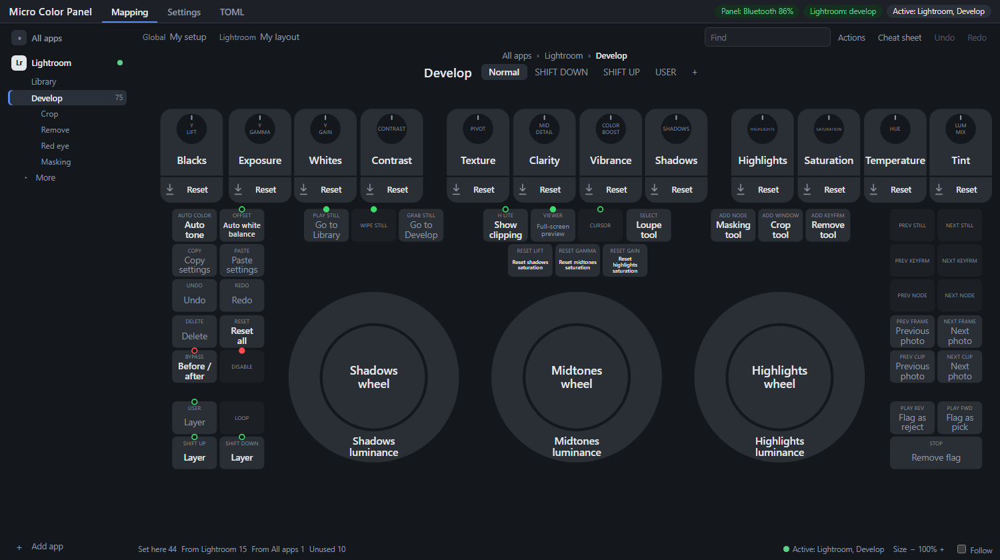

# BMD Micro Color Panel Tools

Protocol info and tools for using the Blackmagic Design Micro Color Panel outside Resolve. This project was researched and written with **Claude**, Anthropic's AI model. Claude
wrote the test scripts, the driver and the spec, and analysed the captures. A human ran
every test on a real panel, did the pressing, rolling and looking, and reviewed each result
before it went into the spec.

> Not affiliated with or endorsed by Blackmagic Design or Adobe. "DaVinci Resolve" and "Blackmagic Design" are
> trademarks of Blackmagic Design Pty Ltd, "Adobe" and "Lightroom" of Adobe. Everything here was found by observing the
> panel's own USB/Bluetooth traffic.

**There are two separate things here. Which one are you looking for?**

| | [🎛️ **The helper**](#the-helper-use-your-panel-with-other-programs) | [🔧 **The protocol**](#the-protocol-and-developer-tools) |
|---|---|---|
| **For** | people who want to *use* the panel with Lightroom or other programs | programmers who want to *know how the panel works* or write their own software |
| **What it is** | a ready-made program for Windows: download, start, click | a tested specification, a small Python driver, test scripts and recordings |
| **You need** | Windows 10 or 11 and the panel. No programming. | Python, and the panel to try things |
| **Start here** | **[User guide](docs/GUIDE.md)** | **[Developer guide](docs/DEVELOPERS.md)** |

You don't need anything from the second column to use the first.

---

## The helper: use your panel with other programs

It lets the panel control Lightroom Classic, anything with keyboard shortcuts, and programs that speak MIDI, Mackie
Control or OSC. Each program can have its own layout.

1. **Download** `MicroPanel-…-windows-x64.zip` from the
   **[latest release](https://github.com/Bipedal/BMD-MicroColorPanel-Tools/releases/latest)** and extract it to a folder
   where it can stay.
2. **Connect** the panel by USB, or pair it over Bluetooth in Windows' settings. Close DaVinci Resolve.
3. **Start** `micropanel.exe`. The mapping editor opens in your browser. Nothing is installed and no driver changes.
4. **Click a control** on the drawing, or touch it on the panel, and choose what it does.

**For Lightroom Classic:** in the editor, **Settings > Install the plugin**, then restart Lightroom.

Windows may say it protected your PC, because the program isn't signed: **More info > Run anyway**. GitHub builds it from
the source here ([how](.github/workflows/release.yml)); each release has a checksum.

➡️ **[User guide](docs/GUIDE.md)**: setup, layouts, layers, lights, cheat sheet, troubleshooting ·
**[Lightroom guide](lightroom/README.md)** ·
**[Changes](CHANGES.md)** · **[Report a problem](https://github.com/Bipedal/BMD-MicroColorPanel-Tools/issues)**

Never hold **AUTO COLOR and STOP together** (it resets the panel and clears its Bluetooth pairing), and never replace the
panel's Windows driver (Zadig, WinUSB).

| Folder | What it is |
|---|---|
| [`docs/`](docs) | the guides |
| [`helper/`](helper) | the helper's source (Rust); building it, and its settings file |
| [`integrations/`](integrations) | the released program: the helper with its Lightroom part |
| [`lightroom/`](lightroom) | the Lightroom Classic plugin and its guide |

---

## The protocol and developer tools

For programmers. Nothing here is needed to use the helper.

How the panel talks to a computer over **USB and Bluetooth**, with the evidence for every statement, so that you can write
your own software for it in any language.

➡️ **[Developer guide](docs/DEVELOPERS.md)**: the protocol in a paragraph, trying it with Python, writing your own driver ·
**[The specification](PANEL_PROTOCOL.md)**

| File or folder | What it is |
|---|---|
| [`PANEL_PROTOCOL.md`](PANEL_PROTOCOL.md) | **The specification.** Every statement is tagged **[V]** verified (with the log that shows it), **[A]** assumed, **[D]** from documentation, or **[?]** open. |
| [`panel.py`](panel.py) | Reference driver (hidapi): init and keep-alive, decoded buttons / balls / rings / knobs, key LEDs, backlight, battery, firmware/serial info, state re-sync, automatic reconnect across USB and Bluetooth. |
| [`panel_tester.py`](panel_tester.py) | A window that draws the panel and shows every key, knob, ball and ring live, with a backlight slider and clickable key LEDs. `--demo` runs without a panel. |
| [`tests/`](tests) | The test scripts that produced the evidence. |
| [`logs/`](logs) | The raw logs and USB captures cited in the specification. |
| [`tools/`](tools) | Scripts that build this public copy and the release. |

---

## Status

Tested on one panel (firmware 2.2.0) with Windows 11, Python 3.14 and hidapi 0.15, over USB
and Bluetooth, between 2026-11-15 and 2026-11-18; the helper until 2026-11-24 on Windows 11, with
Lightroom Classic 16.0 in English. Linux and macOS notes in the spec are
untested. Open questions are listed in spec §9.

## Licence

**CC0 1.0 Universal (public domain dedication).** Code, spec and logs alike: use it for
anything, no attribution required. See [`LICENSE`](LICENSE).
