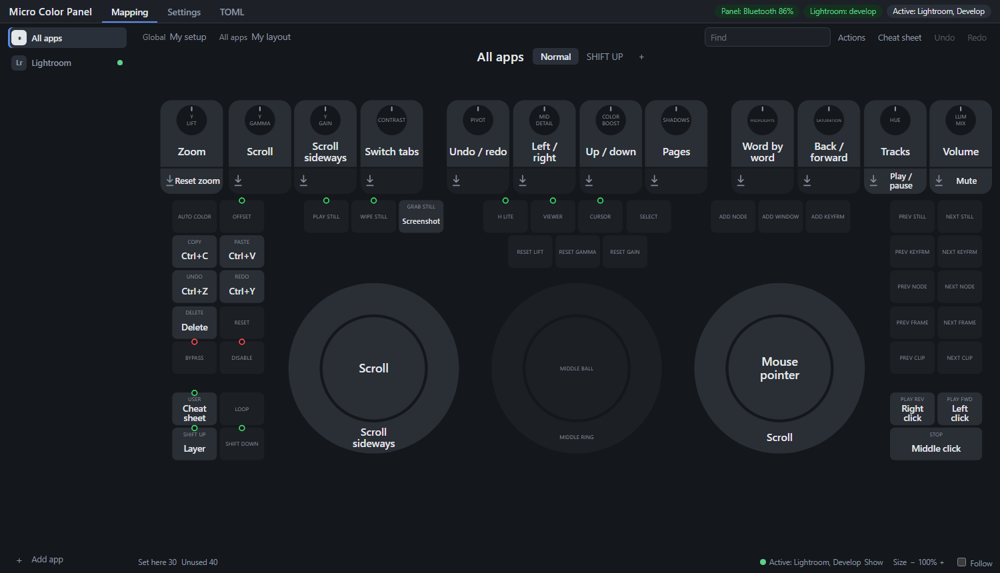
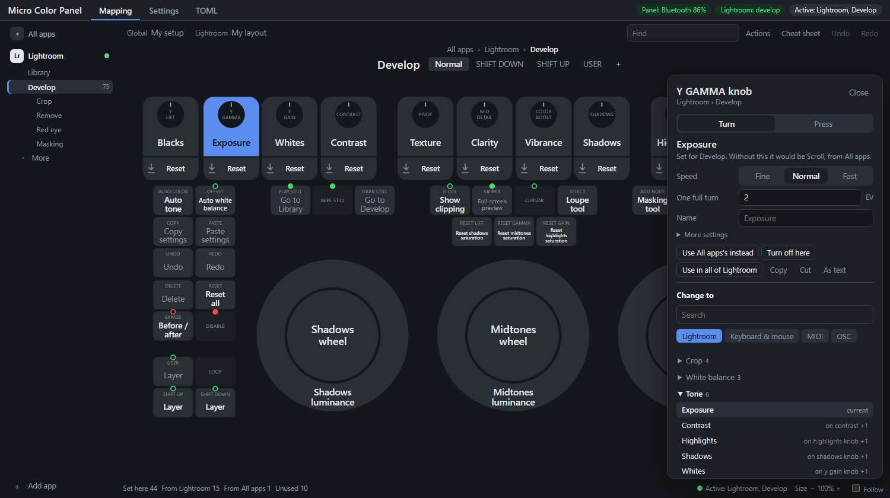
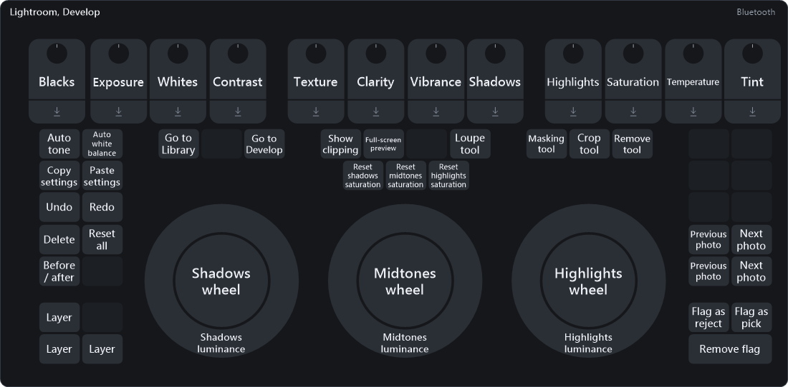

# User guide

How to use the DaVinci Resolve Micro Color Panel with other programs on Windows. No programming needed.

[Set it up](#1-set-it-up) · [Change what a control does](#2-change-what-a-control-does) ·
[A layout for each program](#3-a-layout-for-each-program) · [Layers](#4-layers-more-on-the-same-keys) ·
[Lights](#5-lights) · [Cheat sheet](#6-the-cheat-sheet) · [Presets](#7-presets) ·
[Lightroom Classic](#8-lightroom-classic) · [MIDI, Mackie Control, OSC](#9-midi-mackie-control-and-osc) ·
[Settings](#10-settings-worth-knowing) · [Update or remove](#11-update-or-remove) ·
[If something doesn't work](#12-if-something-doesnt-work)

> **Two things never to do**
> - Never hold **AUTO COLOR and STOP together**: that resets the panel and clears its Bluetooth pairing.
> - Never replace the panel's Windows driver (Zadig, WinUSB): DaVinci Resolve needs the normal one.

## 1. Set it up

You need Windows 10 or 11 (64-bit) and the panel. DaVinci Resolve doesn't have to be installed.

1. Download `MicroPanel-…-windows-x64.zip` from the
   [latest release](https://github.com/Bipedal/BMD-MicroColorPanel-Tools/releases/latest).
2. Right-click the zip, **Extract all**, into a folder where it can stay, for example `C:\Tools\MicroPanel`. Don't
   start it from inside the zip.
3. Connect the panel: plug in its USB cable, or pair it under Windows' **Settings > Bluetooth & devices**. Pairing once
   is enough. With both, the cable is used while it is plugged in.
4. Close DaVinci Resolve. While it runs, the panel belongs to it.
5. Start `micropanel.exe`.
   - *"Windows protected your PC"*: the program isn't signed. **More info > Run anyway**.
   - The mapping editor opens in your browser. It runs on your PC only.
6. At the top right it should say **Panel: USB** or **Panel: Bluetooth**. Roll the right ball: the mouse pointer moves.

From now on the helper is the icon next to the clock; Windows may hide it behind the **^**. Right-click it for **Edit
mappings…** (the editor), **Pause**, **Start with Windows** and **Quit**. Starting `micropanel.exe` again opens the
editor too.

### What it does at first

It works in every program: the right ball is the mouse, with PLAY FWD, STOP and PLAY REV as its left, middle and right
button. The left ball and the outer rings scroll. The knobs zoom, scroll, switch tabs, undo, move the cursor and change
the volume. **Press USER** to see
all of it in a small window.

## 2. Change what a control does

1. **Pick the control:** click it on the drawing, or touch it on the panel.
2. **Pick the action** in the panel that opens, under **Choose what it does** (or **Change to**). Type in *Search* or open
   a group.

That's it: every change is saved at once and works immediately. **Undo** and **Redo** are at the top right.

- **Knobs** have two sides: **Turn** and **Press**. Balls and rings too: **Ball** and **Ring**.
- **Keyboard shortcuts:** choose *Keyboard shortcut…*, then press the keys.
- **Speed:** *Fine / Normal / Fast*, or type how much one full turn changes.
- **Name:** give it your own, for example "Toggle flagged" instead of "Backquote".
- **Copy, Cut, Paste** (Ctrl+C, X, V) work from one control to another, also between programs.
- **Drag** a control onto another to move what it does; a knob takes its press along. If the other one is set, the two
  swap. Hold **Ctrl** while dropping to copy instead. To put it into a layer or another place, rest on the layer's key
  above the drawing, or on the place in the list at the left, until the view changes, then drop.
- **Actions** at the top lists everything; click one and then a control, or drag it there.
- **Find** (Ctrl+K) shows where something is assigned.

On the drawing, bright text is set right here; grey text comes from somewhere more general (next section).

## 3. A layout for each program

At the left are **All apps** and the programs with a layout of their own; the one you choose opens to its parts and
tools (for Lightroom: Library, Develop with Crop, Remove, Red eye, Masking, and *More*). **Add app** lists the programs
that are open; choose one. Above the drawing, the path (*All apps › Lightroom › Develop › Masking*) shows where a
control falls back to when it isn't set here; click a part of it to go there.

Then change controls as above. They apply while that program is in front. A control you don't set there keeps doing what
it does in **All apps**.

| Button | |
|---|---|
| **Use All apps's instead** | remove what is set here |
| **Turn off here** | the control does nothing in this program |
| **Use in all of …** | use this in the whole program, not only in this part |

Lightroom also has parts: **Library**, **Develop**, and Develop's tools. The helper follows you from one to the other.

Tick **Follow** at the bottom right if the editor should show the program you are in.

## 4. Layers: more on the same keys

A layer is a second set of assignments, for example a second page of knobs. At first SHIFT UP opens an empty one.

1. Next to **Normal**, click **+**.
2. Give the layer a name, and press the key on the panel that should open it.
3. *Stays open:* **Tap to keep, or hold** (a tap keeps it open, a hold only while you hold it), **While held**, or
   **Until the next tap**.
4. Click the layer's key next to **Normal** and assign controls.

What you leave empty does **nothing** while the layer is open, so a layer only does what you gave it. Keys that open
or close layers always work. Tick **Unset controls keep their normal job** next to the layer's name if it should
only change some controls and leave the rest as they are. **Rename** and **Delete layer** are there too.

## 5. Lights

Eleven keys have a light: BYPASS and DISABLE (red); USER, OFFSET, SHIFT UP, SHIFT DOWN, PLAY STILL, WIPE STILL, H LITE,
VIEWER and CURSOR (green). Select the key; under **Light**, **Turns on** says when: while a layer is open, for a
Lightroom flag or colour label, for a MIDI or OSC value. A key that opens a layer lights by itself while it is open.

## 6. The cheat sheet

A small window that shows what every control does right now, for the program in front and the open layer. It never takes
the focus from your program. Open it with USER, with **Cheat sheet** in the editor, or from the tray icon (**Cheat sheet >
Show**). In Lightroom's starting layout USER is the mouse instead, so use one of the others there.

Drag it to move it, drag its right or bottom edge to resize it. Its header has a list view, the transparency and the
panel's connection. In the tray menu, **Clicks go through it** makes it ignore the mouse.

## 7. Presets

A preset is a whole layout under a name. The two names at the top left are the **Global** preset (for everything at once)
and the one of the program you are looking at. Click one to switch, to save the layout as a new preset (**Save as new…**),
or to go back to the built-in **Starter**. What you change goes into the preset in use; Starter itself stays as it is.
**Export** and **Import…** carry a program's preset to another PC. A key can switch presets too.

## 8. Lightroom Classic

1. In the editor: **Settings > Install the plugin**.
2. Restart Lightroom Classic. At the top the editor then says **Lightroom: library** (or where you are). Lightroom may
   take a few minutes to load; until then it says *not connected*.

The knobs are then Lightroom's sliders (press one to reset it), the balls are the colour wheels, and the lights show flags
and labels. What it can do, what it needs and what to do if it doesn't connect: **[Lightroom guide](../lightroom/README.md)**.

## 9. MIDI, Mackie Control and OSC

For music and video programs, media servers and the like. These are the **MIDI** and **OSC** groups when you choose an
action.

- **MIDI and Mackie Control:** to reach a program on the same PC you need a loopback port: Windows MIDI Services (its
  *Default App Loopback*) or loopMIDI. Choose the ports under **Settings**, and the same port in the other program. For
  Mackie Control, add it there as a control surface.
- **OSC:** under **Settings**, either the program's **OSCQuery** address (its parameters then appear in the list), or
  **OSC: send to** with an address such as `127.0.0.1:9000`.

## 10. Settings worth knowing

| | |
|---|---|
| **Backlight**, **Lights off when idle** | how bright, and when they go off |
| **On battery, let the panel rest** | after this long without using the panel or the PC, it switches its reports off too and lasts much longer. Using the PC wakes it; touching the panel alone doesn't. |
| **Knobs and rings / Balls: ignore the first …** | so that a bump changes nothing. Raise it if things change by accident, lower it if they start too late. |
| **After pressing a knob, ignore small turns** | so that pressing to reset doesn't also turn |
| **Pointer smoothing** | higher is smoother, lower is quicker |
| **When DaVinci Resolve runs** | give it the panel (normal), or keep using it |
| **Restart the helper: hold … + … for …** | one or two keys that, held together, restart the helper, even when it hangs. They keep their own jobs. Off at first. |

## 11. Update or remove

**Update:** tray icon > **Quit**, replace `micropanel.exe` with the new one, start it. Your layouts stay. If the editor
says the Lightroom plugin is out of date: **Settings > Replace the plugin**, then restart Lightroom.

**Remove:**
1. If you used Lightroom: **Settings > Remove the plugin**.
2. Tray icon: untick **Start with Windows**, then **Quit**.
3. Delete the folder with `micropanel.exe`, and `%APPDATA%\MicroPanel` (your layouts and the log).

**Back up** your layouts by copying `%APPDATA%\MicroPanel`.

## 12. If something doesn't work

| What you see | What to do |
|---|---|
| Nothing happens when it starts | It is the icon next to the clock, perhaps behind the **^**. Start it again: the editor opens. |
| **Panel: not connected** | Is DaVinci Resolve running? Then it has the panel. Otherwise replug the USB cable, or switch Windows' Bluetooth off and on. |
| Bluetooth connects, but nothing reacts or it drops every half minute | Switch Windows' Bluetooth off and on. This happened here once; the PC's side was stuck. |
| The panel is dark | It rests on battery after 15 minutes without use. Use the mouse or keyboard, wait a moment, touch the panel. |
| It works everywhere but in one program | Does that program run as administrator? Then the helper has to as well. |
| A shortcut does something else than expected | Shortcuts depend on the program's own settings and keyboard language. |
| **Lightroom: not connected** | [Lightroom guide](../lightroom/README.md#if-it-doesnt-connect) |
| The editor says it can't reach the helper | The helper isn't running. Start `micropanel.exe`. |
| The tray icon or editor stops reacting, or the panel does nothing | Tray icon > **Restart**. If the icon doesn't react either: hold the keys you chose under **Settings > Restart the helper**. Please report it with the log. |

Still stuck? [Report it](https://github.com/Bipedal/BMD-MicroColorPanel-Tools/issues) with your Windows version, USB or
Bluetooth, and what you did. The log `%APPDATA%\MicroPanel\helper.log` helps; it contains the names of the programs you
used, so look through it first.

---
Not affiliated with or endorsed by Blackmagic Design or Adobe. How the panel itself works is documented separately, for
programmers: [protocol and developer tools](DEVELOPERS.md).
