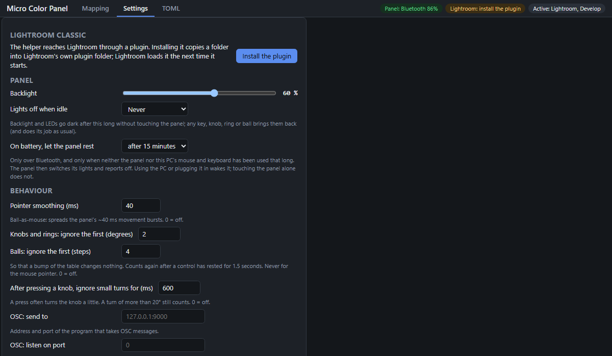

# Lightroom Classic guide

For users of the helper. General things are in the [user guide](../docs/GUIDE.md).

With the helper's Lightroom part, knobs change Lightroom's settings directly, the balls move the colour-grading
wheels, keys run Lightroom commands, the panel's lights show flags and labels, and the layout follows the module
and tool you are in.

## Install

1. Start the helper ([how to get it](../docs/GUIDE.md#1-set-it-up)).
2. In its editor: **Settings > Install the plugin**.
3. Restart Lightroom Classic.

The status at the top of the editor changes to **Lightroom: develop** (or the module you are in). That is all:
Lightroom loads the plugin by itself from then on, and it doesn't matter which of the two starts first. While
Lightroom is still loading, which can take a few minutes, the status stays at "not connected".

*By hand:* copy `MicroPanel.lrplugin` (in the download's folder, or here) to
`%APPDATA%\Adobe\Lightroom\Modules`. Adding it under File > Plug-in Manager works too.

*Update:* after replacing the helper, the editor says when the plugin belongs to another version: **Settings >
Replace the plugin** (in the helper's editor, not in Lightroom), then restart Lightroom.

*Remove:* **Settings > Remove the plugin** in the helper's editor, then restart Lightroom. Or delete that folder while
Lightroom is closed.

## What you need

| | |
|---|---|
| Windows 10 or 11 | The helper's other systems don't have the keyboard and window parts yet. |
| Lightroom **Classic** | The plugin asks for version 10 or newer. Tried with 16.0 only; newer functions (Denoise, Remove, Glow) are missing in older versions. Not the cloud-based "Lightroom", which can't load such plugins. |
| English Lightroom | Only for the masking brush, mask edge and refine, Remove opacity and six buttons (Auto Mask, brush A/B, erase, luminance map, visualize spots). See below. |

## The starting layout

In **Develop**: the knobs are Blacks, Exposure, Whites, Contrast, Texture, Clarity, Vibrance, Shadows, Highlights,
Saturation, Temperature and Tint; press one to reset it. The balls are the shadow, midtone and highlight wheels,
the rings their luminance. Hold SHIFT UP for a second page of knobs, SHIFT DOWN for one fifth of the speed, USER
for the mouse. Elsewhere: previous and next photo, flags, rating, undo and redo.

Click anything in the editor to change it. There are 137 settings and 113 commands, under **Change to >
Lightroom**; each tool (Crop, Remove, Masking …) can have a layout of its own.

## Good to know

- Lightroom shows the value while you turn. Settings has a switch for that.
- Actions only run while Lightroom is in front, and not while one of its dialog boxes is.
- Holding Alt (a key can do that: *hold*) shows Lightroom's clipping and sharpening overlays as usual.
- Copy and paste settings, before/after and full screen are sent as Lightroom's standard shortcuts, because
  plugins can't do them.
- The brush, mask-refinement and Remove-opacity controls aren't open to plugins. The helper moves Lightroom's own
  sliders on screen, found by their English names; if it can't find one it says so and does nothing.
- A turn of a knob is one step in the undo history.

## If it doesn't connect

1. Editor > Settings: is the plugin installed? Was Lightroom restarted since?
2. Lightroom > File > Plug-in Manager: *Micro Color Panel* must be there and running. **Reload Plug-in** often helps.
3. File > Plug-in Extras > Micro Color Panel status shows the plugin's side of the link.
4. Its log is `%LOCALAPPDATA%\Adobe\Lightroom\Logs\LrClassicLogs\MicroPanel.log`, the helper's
   `%APPDATA%\MicroPanel\helper.log`.

## For programmers: how it works

Lightroom plugins can't reach USB devices, so the plugin only talks to the helper: it listens on 127.0.0.1, ports
58781 (plugin to helper) and 58782 (helper to plugin), one JSON object per line. Nothing leaves the PC. As with any
such link, other programs on the same PC could use these ports. The messages are the ones in
[`Core.lua`](MicroPanel.lrplugin/Core.lua) and [`link.rs`](../integrations/lightroom/src/link.rs).

| File | |
|---|---|
| `Core.lua` | all logic, without Lightroom's own calls, so it can be tested outside |
| `Catalog.lua` | the settings and commands |
| `Json.lua` | JSON |
| `MicroPanelInit.lua` | the sockets and Lightroom's calls |

Tests (no Lightroom needed, `pip install lupa`): `python tests/test_lua_core.py`, `…_catalog.py`, `…_json.py`,
`…_sockets.py`. After changing `Catalog.lua`: `python tests/test_lua_catalog.py --write`.

"Adobe" and "Lightroom" are trademarks of Adobe. Not affiliated with or endorsed by Adobe. CC0 1.0.
